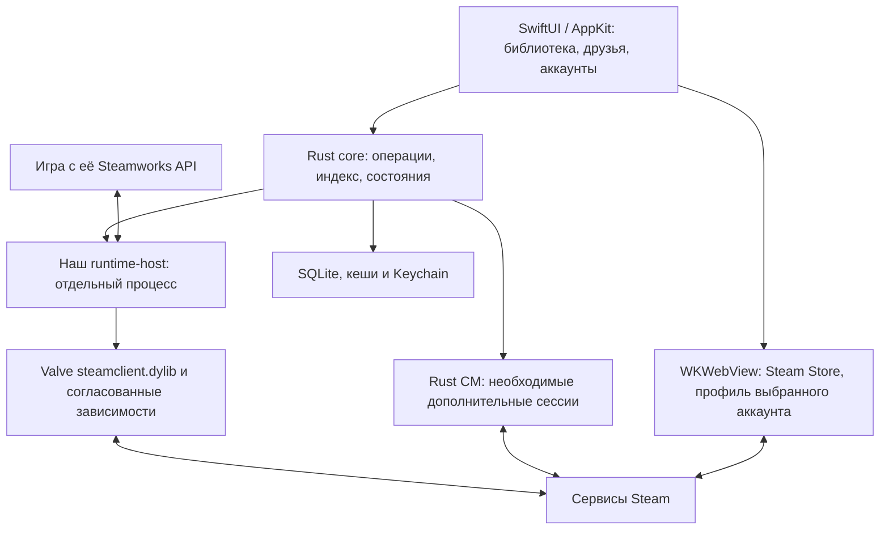

# Самостоятельный клиент Steam для macOS

Актуальное направление SkinOs, 9 октября 2026 года. Этот документ заменяет выбор архитектуры и последовательность работ из первоначального гибридного плана.

**Цель: собственное приложение, которое обслуживает Steam-игры без запущенных официального Steam.app, steam_osx и steamwebhelper.** Rust управляет аккаунтами, библиотекой и операциями; SwiftUI/AppKit предоставляет интерфейс; отдельный процесс SkinOs загружает клиентский движок Valve. Использование `steamclient.dylib` является частью выбранной архитектуры. Полная собственная реализация всех бинарных компонентов Valve не требуется для достижения этой цели.

Главное уточнение исследования: требование Steamworks «нужен работающий Steam client» не доказывает обязательность оригинального приложения и его GUI. OpenSteamClient/OpenSteamworks реализуют режим, в котором собственный процесс становится клиентом, а игры подключаются к нему. Это пропущенный в первоначальном плане вариант. [OpenSteamworks Global instance](https://github.com/OpenSteamClient/OpenSteamworks/blob/master/OpenSteamworks/README.md).

## 1. Что показали существующие проекты

| Проект | Механизм | Что используем в проектировании |
|---|---|---|
| OpenSteamClient, первоначальный C++ | Загружает Valve steamclient.so, создаёт внутренний IClientEngine и клиентские интерфейсы | Архитектуру собственного процесса вместо официального GUI; жизненный цикл и разделение интерфейсов |
| OpenSteamworks и C# remake OpenSteamClient | Различает подключение к существующему клиенту и создание собственного global instance | Global instance как основной путь; управление pipe/user/callbacks и требования к окружению |
| Mist для macOS | Swift UI, прямой протокол и DepotDownloader; Windows-игры через Wine и Steamworks shim | Отдельные реализации авторизации, загрузки и организации клиента; не считать shim универсальным online-runtime |
| Aurelia | Rust CM-протокол, загрузки и Cloud; несколько разных режимов запуска | Примеры сетевых операций и очередей; внимательно разделять direct launch, host Steam и Steam.exe внутри Wine |
| Steamie | Rust-протокол, библиотека и личный чат | Кандидат для сравнения сетевых адаптеров и обработки событий |

Первичные источники: [OpenSteamClient](https://github.com/OpenSteamClient/OpenSteamClient), [OpenSteamworks](https://github.com/OpenSteamClient/OpenSteamworks), [Mist](https://github.com/98przem/mist), [Aurelia](https://github.com/Drackrath/Aurelia), [Steamie](https://github.com/LargeModGames/steamie). Подробности с привязкой к исходникам — в исследованиях [проектов](research/independent-clients-and-takedowns.md), [Rust-runtime](research/standalone-rust-runtime.md) и [macOS-runtime](research/macos-standalone-runtime.md).

У OpenSteamClient сохранился публичный репозиторий: master объявлен устаревшим, автор указывает на C#-переписывание. Утверждение об удалении именно этого проекта по требованию Valve проверенными материалами не подтверждается. Это не влияет на выбор технической архитектуры; реакцию Valve на личное использование также не принимаем как установленный факт.

README Aurelia и Mist не используются как доказательство полного паритета. У Mist документированы отсутствующая загрузка новых сохранений в Cloud и ограничения overlay/online. У Aurelia режим с Wine может запускать настоящий Steam.exe, а просмотренный код исключает нативные macOS launch entries. Сборка CLI для macOS не равна поддержке запуска macOS-игр.

## 2. Архитектура SkinOs

Официальные GUI-процессы не входят в рабочую схему. Возможность открыть Steam не засчитывается как реализация функции SkinOs.

Процессы:

1. **SkinOs UI** — нативный интерфейс и управление окнами. Не вызывает внутренние функции Steam напрямую.
2. **Rust core** — модель аккаунтов, сценарии запуска, локальный индекс, очереди и IPC. На первом этапе может находиться в процессе приложения.
3. **Runtime host** — отдельный исполняемый файл, который владеет игровым движком, его pipe/user, обработкой callbacks и завершением. Его падение не должно уничтожать UI или локальную базу.

На границе приватного C++ API допустим небольшой C++/Objective-C++ слой с простым C ABI. Это позволяет оставить предметную логику на Rust и не разносить небезопасные вызовы vtable по приложению. ABI описывается для конкретной версии и архитектуры библиотеки.

Сетевые возможности, уже доступные через hosted engine, используем через него. Отдельные CM-соединения добавляем для конкретных потребностей, например фоновых профилей. Две независимые реализации не должны одновременно обновлять один и тот же Cloud, установку или игровое состояние.

## 3. Контракт runtime-host

Входящие команды содержат version, request_id, account_id и session_generation. Ответы и события возвращают тот же контекст. Несовместимая версия протокола явно отклоняется.

Первый минимальный набор операций:

- Сведения о загруженном runtime: build fingerprint, архитектура, проверенные интерфейсы.
- Инициализация и завершение клиента с контролируемым жизненным циклом.
- Начало и отмена входа; обновление состояния Steam Guard; подтверждённая идентичность пользователя.
- Получение лицензий и установок.
- Запуск конкретного AppID и наблюдение за его состоянием.
- Подписка на ограниченный набор событий и корректная обработка callbacks.

После подтверждения базового цикла добавляются app management, friends, matchmaking/invites, cloud/UGC и остальные поверхности. UI не получает указатели C++, внутренние handles или универсальную команду вызова произвольного метода.

К каждому проверенному runtime относятся SHA256 бинарников, архитектуры, версии интерфейсов и набор интеграционных тестов. Изменение build fingerprint требует повторной проверки ABI. Наличие экспорта CreateInterface не подтверждает совместимость конкретной vtable.

## 4. Проверка на этом Mac

Найдена установленная `steamclient.dylib` внутри Steam.AppBundle. Статическое исследование показало slices arm64 и x86_64 и экспорты создания pipe/user и чтения callbacks. Это материал для собственного host, но ещё не испытание игрового запуска.

Первый код проекта — Rust-инструмент статической диагностики. Он формирует воспроизводимый отчёт об архитектурах, зависимостях, SHA256, доступных символах и наличии инициализаторов библиотеки. Он не загружает библиотеку в процесс и не выполняет login.

Следующая проверка выполняется отдельно: загрузить согласованный комплект в runtime-host, установить проверенные интерфейсы и получить корректный lifecycle без GUI Steam. Для неё нужно подготовить изолированное состояние runtime и установить, какие пути и IPC endpoints библиотека использует на macOS.

Сам факт отдельного процесса не изолирует файловые изменения и сеть. `dlopen` запускает конструкторы Mach-O, поэтому динамическая фаза начинается после определения условий запуска, а не внутри статической диагностики.

## 5. Последовательность реализации

### R0. Инвентаризация бинарников

Результат: локальный отчёт runtime, список зависимостей и экспортов для каждой архитектуры. Rust CLI собирается и проверяется на установленном бинарнике и ошибочных входных путях.

Критерий завершения: воспроизводимый отчёт без чтения аккаунтов, запуска Steam и изменения его установки. Этот этап является диагностикой, а не готовым игровым клиентом.

**Выполнено 9 октября:** Rust probe собран; проверки форматирования и clippy пройдены; успешный JSON-отчёт и отказ для ошибочных входных файлов проверены. В обеих архитектурах текущего бинарника обнаружены 13 из 13 проверяемых экспортов, 23 объявленные зависимости и секция инициализаторов. Результат: [runtime-inspection.json](../outputs/runtime-inspection.json).

В ходе реализации MVP также подтверждены самостоятельный global runtime, настоящий вход с правильным SteamID, библиотека аккаунта и скачивание Brotato. Завершается проверка игрового запуска и оригинального SDK; актуальная детализация — [MVP verification status](implementation/mvp-status.md).

### R1. Движок в собственном процессе

Работы:

1. Сопоставить текущий macOS build с известными интерфейсами OpenSteamworks/SteamTracking.
2. Проверить зависимости, rpath, архитектуру и условия динамической загрузки.
3. Определить versioned factory/engine interfaces и реализацию callback loop.
4. Запустить собственный host с отдельным состоянием; выяснить требования к локальной регистрации и IPC.
5. Реализовать чистое завершение, timeout и восстановление после падения.

Критерий завершения: движок инициализируется и завершается внутри нашего процесса, без официальных GUI-процессов. Не считать отсутствие окна достаточной проверкой: фиксируется дерево процессов.

### R2. Настоящий аккаунт и лицензии

Реализовать login/Guard, восстановление сессии, логирование без секретов, получение фактического SteamID и лицензий. Вход осуществляется отдельным понятным действием в нашем приложении; секреты существующей установки Steam не импортируются неявно.

Критерий завершения: собственная сессия подтверждает личность и актуальные права аккаунта, корректно переживает отмену входа, истечение токена, потерю сети и перезапуск host.

### R3. Первая Steamworks-игра

Подготовить небольшое тестовое приложение с наблюдаемым SteamID и согласованным AppID, затем проверить принадлежащую пользователю игру. Испытать создание игрового pipe, callbacks, launch metadata и завершение процесса. Не подменять реальные результаты теста фиктивным успешным SteamAPI_Init.

Критерий завершения: игра подключается к нашему host, получает верный SteamID, работает без Steam.app/steam_osx/steamwebhelper, корректно завершается. Отдельный обязательный тест получает настоящий auth-session ticket и подтверждает его на контролируемой принимающей стороне через предусмотренный Steam механизм. Одного чтения SteamID недостаточно для подтверждения online-auth. Сначала нативная macOS-игра; Windows/Wine — отдельная ветка.

### R4. Установка и сохранения

Подключить управление depot/manifest и жизненным циклом установки через выбранный движок. Проверить pause/resume, repair, DLC, языки, ветки, нехватку места и сбой посреди обновления. Отдельно реализовать Cloud до/после игры и разрешение конфликта.

Критерий завершения: цикл «получить игру → установить → запустить → сохранить → выйти → восстановить сохранение» проходит без официального приложения.

### R5. Первый удобный интерфейс

SwiftUI/AppKit оболочка, библиотека, поиск, карточка игры, очередь загрузок, аккаунты и настройки. Экраны отображают реальные данные R2–R4. Допустимы явно обозначенные fixtures в процессе дизайна, но они не считаются работающей интеграцией.

Критерий завершения: повседневный запуск и обслуживание игр доступны из собственного UI, сохраняют отзывчивость при загрузке и реконнекте.

### R6. Мультиаккаунт и магазин

Добавить сохранённые аккаунты, объединённую библиотеку, предпочтительный аккаунт игры и независимые web profiles магазина. Игровой аккаунт переключается самим runtime-host; официальный клиент не участвует.

Магазин работает через подлинные страницы Steam внутри изолированного WKWebView. Баланс, корзина, покупка и пополнение относятся к фактическому аккаунту страницы; платежи проходят штатный checkout. Это не требует desktop Steam.

Критерий завершения: две учётные записи с одной и той же игрой дают правильный SteamID, лицензии, корзины и сохранения; операция не меняет владельца из-за переключения видимого профиля.

### R7. Социальные и игровые функции

Друзья, presence, личные сообщения и история; затем группы, медиа и голос. Для приглашений отдельно покрыть lobby, rich presence и подключение к серверу при запущенной и закрытой игре.

Cloud, Workshop, достижения, Families, overlay, Steam Input, Remote Play, скриншоты и запись получают собственные сценарии проверки. Отдельно нужен совместимый backend для игрового ISteamHTMLSurface: встроенный WKWebView магазина его автоматически не реализует. В OpenSteamClient игры с этим интерфейсом отмечены как несовместимые, поэтому задачу нельзя потерять при исключении steamwebhelper. Поддержка определяется по версии macOS и реальному поведению, а не по одинаковому названию API. [README OpenSteamClient](https://github.com/OpenSteamClient/OpenSteamClient/blob/b6703299c982315a0efdf8d6bcea330ab931614b/README.md).

### R8. Полнота и ежедневное использование

Закрыть реестр функций базовой macOS-версии Steam, выполнить soak-тесты, accessibility, локализацию, обновление и откат. Измерять всю группу процессов SkinOs, включая host и WebKit. Проверять расход ресурсов после закрытия магазина и при нескольких социальных сессиях.

## 6. Мультиаккаунт в выбранной архитектуре

Один каталог игр объединяет доступность по нескольким аккаунтам. Отдельные состояния: видимый профиль UI, сетевая сессия, web profile, игровой пользователь runtime и владелец семейной копии.

В первой реализации runtime обслуживает одного активного игрового пользователя. Это не требует ограничения количества сохранённых аккаунтов или фоновых социальных профилей. Поддержку нескольких одновременно активных игровых пользователей добавляем после исследования внутренних user handles и IPC-изоляции.

Запуск с аккаунта B:

1. Зафиксировать AppID, SteamID игрока и источник лицензии.
2. Дождаться завершения несовместимой активной игровой операции и Cloud.
3. Подготовить правильную сессию в нашем host.
4. Подтвердить SteamID, лицензию, доступность семейной копии и нужных DLC.
5. Определить локальные файлы сохранения и возможное пересечение путей с другим профилем.
6. Запустить игру и проверить игровой контекст.
7. После выхода завершить синхронизацию и обновить состояние библиотеки.

Session generation не позволяет старым callback или сетевым ответам восстановить данные удалённого/перелогиненного профиля. Установку в любой момент изменяет только один менеджер; временные каталоги отделены от готовой версии.

## 7. Реестр полного паритета

Требование «все функции» сохраняется. Для каждой строки фиксируются сценарии, версия движка, macOS, выбранные игры и последняя успешная проверка. Непроверенная строка остаётся незавершённой работой.

| Группа | Обязательные сценарии |
|---|---|
| Аккаунты | Guard, сохранение/отзыв сессии, offline-состояния, переключение и удаление профиля |
| Библиотека | Все доступные игры, коллекции, поиск, скрытие, внешние игры, launch options |
| Установки | Install/update/uninstall/verify/move, очередь, ограничения скорости, DLC, языки и beta |
| Запуск | Steamworks IPC, идентичность, лицензия, аргументы, наблюдение за игрой, offline по поддержанным условиям |
| Магазин | Каталог, wishlist, баланс, корзина, покупка, подарки, ключи, пополнение, история и возвраты |
| Общение | Друзья, presence, блокировки, личный и групповой чат, история, вложения, voice |
| Multiplayer | Приглашение/принятие, lobby, rich presence, сервер, запуск по приглашению |
| Прогресс | Достижения, время игры, Cloud до/после запуска, конфликт и восстановление |
| Community | Профили, обзоры, руководства, обсуждения, инвентарь, обмены, Market, Points Shop |
| Контент | Workshop, зависимости и обновления, пользовательский контент |
| Семья | Правильные player/owner, выбор копии, ограничения и доступность DLC |
| Runtime | Overlay, Steam Input, Remote Play, игровой ISteamHTMLSurface, скриншоты/запись по macOS baseline |
| Приложение | Темы, клавиатура, VoiceOver, уведомления, локализация, обновление и откат |

Переход в официальный desktop Steam не закрывает строку. Подлинный Store внутри приложения является выбранной реализацией магазина; собственное воспроизведение всего сайта не нужно для покупки из SkinOs.

## 8. Дизайн и производительность

Основные экраны нативные, с локальным индексом и выборочным обновлением. Оформление: две темы, акцент, плотность, размер карточек, компактная таблица и командная панель. Настройки аккаунта и основной пользовательский интерфейс не должны раскрывать внутренние ABI или названия библиотек; техническая диагностика находится отдельно.

Rust + SwiftUI/AppKit остаётся исходным стеком. Tauri допустим после A/B-проверки, если требуемая кастомизация существенно проще и соблюдены бюджеты ресурсов. Решение о runtime не зависит от выбора GUI.

Начальные цели: интерактивная кешированная библиотека до 2 секунд на выбранном базовом Mac; поиск по 10 000 играм p95 до 50 мс; плавная прокрутка 60 Гц; отсутствие длительных UI-блокировок; отсутствие устойчивого роста памяти. Это цели будущих замеров.

Для R1–R3 сначала измеряем собственный runtime-host. Убираем зависимость от официального GUI, но расход самого движка учитываем целиком. WebKit запускается для нужных веб-разделов и выгружается по проверенной политике lifecycle.

## 9. Решения, которые принимаются по результату прототипа

- Какие private ClientAPI версии соответствуют текущему macOS runtime.
- Какие штатные вспомогательные процессы движка действительно нужны для выбранных функций.
- Как организовать собственные paths/IPC без конфликта с установленным Steam.
- Нужны ли отдельные arm64 и x86_64 hosts для конкретных игр и функций.
- Как переключать пользователей движка и можно ли обслуживать несколько игровых пользователей одновременно.
- Какие операции удобнее выполнять через engine, а какие через собственную CM-сессию.

Это список работ, а не основание возвращаться к предыдущему гибридному продукту. Если один механизм не подходит, исследуется следующий в рамках цели самостоятельного клиента. При этом стадия не объявляется завершённой до измеримого результата.

Сроки старого гибридного плана не переносятся на эту архитектуру. Сначала закрываются R1–R3; после настоящего игрового запуска оцениваются оставшиеся интеграции. Внешний вид можно проектировать параллельно, но он не заменяет эту проверку.
