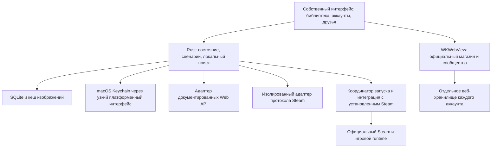

# План разработки альтернативного клиента Steam для macOS

**Архив первоначального гибридного подхода.** По уточнению пользователя основное направление заменено на [самостоятельный клиент с собственным runtime-host](standalone-client-plan.ru.md). Ниже сохранена первоначальная оценка; её требования запускать официальный desktop Steam и сроки больше не являются действующим планом. Исследование OpenSteamClient показало пропущенную возможность загрузки движка Valve собственным процессом.

Дата проверки источников: 9 октября 2026 года. Рабочее место проекта: `SkinOs`. Это план продукта и разработки; приложение и проверки на реальных аккаунтах пока не реализованы.

**Рекомендация: Rust для ядра, SwiftUI и AppKit для интерфейса macOS, WKWebView для официального магазина.** Tauri 2 с Svelte и TypeScript — второй кандидат, который стоит сравнить на коротком прототипе до окончательного выбора. Для macOS приоритет отдаётся нативному интерфейсу; для свободной CSS-кастомизации и будущей поддержки Windows/Linux преимущество у Tauri.

Главная неопределённость находится в интеграции со Steam. Можно спроектировать быстрый собственный интерфейс и несколько аккаунтов. **Полную независимую замену всех функций Steam нельзя честно гарантировать на основе доступных публичных API.** Первый продукт должен использовать официальный Steam там, где он обеспечивает совместимость с играми. Самостоятельный игровой runtime — отдельное исследовательское направление с проверками реализуемости.

## 1. Что именно строим

Цель — приложение, в котором повседневные действия выполняются быстро: найти игру, выбрать аккаунт, запустить, написать другу, принять приглашение, купить игру, посмотреть загрузку. Своя библиотека, навигация, поиск, экран друзей и управление аккаунтами должны работать без загрузки веб-страниц.

Исходные проектные решения:

- Первая платформа — macOS; Apple Silicon является основной тестовой платформой. Поддержку Intel оцениваем отдельно по доступности оборудования и зависимостей.
- Предлагаемый минимум — macOS 14 ради отдельных постоянных веб-профилей. Это наше продуктовое решение, а не утверждение о минимальной версии официального Steam.
- Начальный продукт локальный: без обязательной регистрации в нашем сервисе, без хранения Steam-сессий на нашем сервере.
- Список функций сравнивается с зафиксированной версией официального клиента **для macOS**. Возможности Windows, которых нет на Mac, не становятся автоматически обязательствами проекта.
- Поддержка запуска Windows-игр через сторонние среды — отдельное расширение. Альтернативный клиент сам по себе не делает несовместимую игру совместимой с macOS.
- Данные можно смотреть из локального кеша без сети. Это не означает доступность офлайн-запуска любой игры.

У каждой функции в реестре будет один из способов исполнения: собственный интерфейс и реализация; официальный сайт внутри приложения; переход в официальный клиент; эксперимент; недоступно. Последние два статуса не считаются выполненным требованием.

**Доступ к функции через официальный Steam и собственная реализация функции — разные результаты.** Переход в Steam полезен для первой версии, но не закрывает требование полного собственного интерфейса. Такой долг остаётся в плане до отдельного решения.

## 2. Ограничения, которые определяют архитектуру

Steamworks SDK предназначен для интеграции приложений со Steam и требует запущенного клиента. Rust-обёртка над SDK не превращает его в независимый клиент. Официальная документация также описывает запуск через `steam://run/<AppID>`. Это основание для совместимого запуска, но не публичный механизм выбора любого аккаунта. [Steamworks API Overview](https://partner.steamgames.com/doc/sdk/api).

Steam OpenID подтверждает SteamID для стороннего сервиса. Он не выдаёт нашему приложению полноценную сессию магазина, чата и игрового клиента. Эти виды авторизации нужно проектировать раздельно. [User Authentication and Ownership](https://partner.steamgames.com/doc/features/auth).

Существующие независимые клиенты показывают, что библиотека и чат достижимы. Например, Rust-клиент Steamie заявляет поддержку macOS, QR-входа и личных сообщений, но запускает обычные игры через Steam; прямой запуск ограничен экспериментальным режимом для подходящих игр. Это полезная отправная точка, а не доказательство полной замены. [Steamie](https://github.com/LargeModGames/steamie).

Нельзя закладывать предположение, что официальный Steam можно стабильно использовать как документированный сервис без интерфейса и браузерных процессов. Свёрнутое окно не означает выгрузку этих процессов. Производительность гибридного варианта измеряем вместе с необходимыми процессами Steam.

До публичного распространения нужен отдельный разбор актуальных условий Valve, использования бренда и лицензий зависимостей. В соглашении присутствуют ограничения на стороннее вмешательство, эмуляцию протоколов и автоматизацию. Открытая лицензия сторонней библиотеки сама по себе не предоставляет разрешение Valve. Это вопрос для проверки применительно к конкретной реализации, а не вывод о том, что любое стороннее приложение запрещено. [Steam Subscriber Agreement](https://store.steampowered.com/subscriber_agreement/).

## 3. Матрица функций

Таблица задаёт предполагаемый путь реализации. Реальная поддержка подтверждается тестами; наличие похожего API не считается готовой функцией.

| Функция | Первая реализация | Что нужно для полноценного собственного клиента |
|---|---|---|
| Библиотека, поиск, фильтры, коллекции | Свой интерфейс и локальный индекс | Надёжно получать полную библиотеку конкретного аккаунта, учитывать приватность и устаревание данных |
| Установленные игры и диски | Чтение локальных метаданных, сопоставление с библиотекой | Проверка повреждённых файлов, внешних дисков и изменений со стороны Steam |
| Несколько аккаунтов | Отдельные профили, сессии и кеши | Проверить одновременные подключения и сосуществование с официальным клиентом |
| Выбор аккаунта для игры | Собственный выбор плюс проверяемый запуск через Steam | Надёжный способ переключить и подтвердить игровой аккаунт; иначе требуется действие пользователя |
| Установка, обновление, удаление | Поручать Steam; свой статус только при достоверном источнике | Собственный загрузчик и менеджер установок с большой матрицей совместимости |
| DLC, языки, ветки beta | Первоначально управление через Steam | Лицензии, depot/manifest, пароли веток, согласованность установленной сборки |
| Друзья, статусы, личные сообщения | Цель — собственный интерфейс через проверенный протокольный адаптер | История, повторное подключение, блокировки, подтверждения отправки |
| Групповые чаты, роли, вложения | Официальный интерфейс при необходимости | Отдельное подтверждение поддержки протоколом и библиотекой |
| Голосовые чаты | Первоначально официальный Steam Chat | Аудиотранспорт, устройства, разрешения, реконнект и качество; Steam Voice SDK не равен готовому сервису звонков |
| Приглашения и Join Game | Свой приём/показ, выполнение через проверенный путь | Различать lobby invite, rich presence, сервер и специфическую интеграцию игры |
| Магазин, поиск, страницы игр | Официальные страницы в отдельном WKWebView | Собственная витрина возможна лишь после проверки источников данных и условий их использования |
| Баланс и валюта | Официальная страница; отдельный виджет только при надёжных данных | Отдельный источник для каждого аккаунта, актуальность после операций |
| Корзина и покупка игры | Официальный checkout в профиле выбранного аккаунта | Не существует подтверждённого универсального публичного checkout API для этой задачи |
| Пополнение, подарки, ключи, история покупок, возвраты | Официальные страницы | Проверить каждый сценарий, регионы, подтверждения и переходы к платёжным провайдерам |
| Wishlist, обзоры, руководства, обсуждения, профиль | Веб-разделы; затем выбранные собственные экраны | Изменение и чтение — разные права и разные интерфейсы |
| Инвентарь, обмены, торговая площадка, Points Shop | Официальные страницы и подтверждения | Отдельный большой набор ограничений; не смешивать с обычным checkout |
| Достижения и время игры | Просмотр доступных данных в своём интерфейсе | Обновление достижений самой игрой остаётся в её интеграции со Steam |
| Steam Cloud и конфликты сохранений | Официальная синхронизация, бережное сопровождение запуска | Работа с каждой конфигурацией игры, безопасное разрешение конфликтов и отсутствие двух писателей |
| Workshop | Просмотр вебом, установка через Steam | Зависимости, обновления, версии, лицензии и подписки по конкретным играм |
| Steam Families | Отображение проверенных прав, официальный путь управления | Не сводить семейную лицензию к обычному владению или логину другого аккаунта |
| Overlay, Steam Input, Remote Play | Возможности официального runtime, где доступны на macOS | Самостоятельные крупные подсистемы; не закрываются сменой GUI |
| Скриншоты, записи, трансляции | Проверить доступность в выбранном macOS baseline, официальный путь | Собственный просмотр/организация отдельно от записи, overlay и публикации |
| Offline Mode, внешние игры, launch options, настройки | Проверенные сценарии через Steam плюс свои настройки | Проверка кэша лицензий, аргументов запуска и поведения каждой игры |
| Accessibility, локализация, уведомления, обновление клиента | Собственная реализация с начала проекта | VoiceOver, клавиатура, масштабирование, локализованные ошибки, безопасное обновление |

Источники и подробные ограничения находятся в [исследовании возможностей Steam](research/steam-capabilities.md). По мере разработки таблица превращается в реестр сценариев с версией Steam, платформой, способом исполнения, последним успешным тестом и известными ограничениями.

## 4. Rust и выбор GUI

| Критерий | Rust + SwiftUI/AppKit | Rust + Tauri 2 + Svelte/TypeScript |
|---|---|---|
| Нативное поведение macOS | Прямой доступ к системным компонентам | Часть поведения потребует плагина или платформенного кода |
| Сильно изменяемый внешний вид | Возможен, но сложные компоненты требуют Swift/AppKit | HTML/CSS удобны для тем, плотности, сеток и произвольных компоновок |
| Модель рендеринга | Нативный интерфейс; WebKit подключается для веб-разделов | Локальный интерфейс также работает в системном WebView |
| Большая библиотека | AppKit collection/table views и выборочное обновление | Виртуализированные списки/сетки и ограниченные обновления DOM |
| Связь с Rust | FFI, например UniFFI; требуется дисциплина типов и concurrency | Команды и события Tauri; требуется дисциплина IPC и размеров сообщений |
| Другие ОС | Потребуется другой frontend | Общая база frontend и ядра, платформенные исключения останутся |
| Кто быстрее и экономнее | Определяется замерами нашего прототипа | Определяется замерами нашего прототипа |

Tauri использует системный WebView; это не приложение без браузерного движка. Ни Rust, ни Swift сами по себе не гарантируют отсутствие лагов. Основные решения: не блокировать UI, не рендерить тысячи невидимых карточек, не пересылать всю библиотеку при каждом событии, ограничивать память изображений. [Модель процессов Tauri](https://v2.tauri.app/concept/process-model/).

Мой исходный выбор — **SwiftUI для оболочки, AppKit для сложных таблиц/сеток и окон, Rust для логики**. Это соответствует приоритету macOS. На первом этапе делаем одинаковые мини-прототипы библиотеки, переключения аккаунта и чата на Swift и Tauri. Если Tauri проходит бюджет производительности и заметно упрощает необходимую кастомизацию, выбираем его. После решения второй frontend не поддерживаем.

Предполагаемый набор компонентов ядра: Tokio для асинхронных задач, SQLite для локальных данных и поиска, типизированная сериализация, ограниченный дисковый кеш изображений, структурированные логи без секретов. Конкретные версии и crates закрепляем после прототипов, аудита зависимостей и проверки macOS-сборки.

Для Swift/Rust необходимо проверить lifecycle объектов, callbacks, отмену задач, обработку ошибок и Swift concurrency. UniFFI — кандидат, а не обязательная зависимость. В случае проблем остаётся небольшой явно спроектированный C ABI. Подробнее: [исследование стека macOS](research/macos-stack.md).

## 5. Архитектура приложения



Ядро не зависит от конкретного GUI. Оно принимает команды с явным контекстом аккаунта и выдаёт компактные события. UI получает готовые выборки, а не самостоятельно разбирает сетевые ответы, VDF и состояние загрузчика.

Основные модули:

1. **Accounts** — список профилей, их состояния авторизации и ссылки на секреты.
2. **Library** — каталог игр, владение и доступность по аккаунтам, установки, поиск, коллекции.
3. **Social** — друзья, присутствие, сообщения, приглашения, восстановление подключения.
4. **Launch coordinator** — выбор аккаунта, проверка условий, запуск и наблюдение за завершением.
5. **Steam integration** — чтение локальных данных и выполнение поддержанных действий через Steam.
6. **Store sessions** — создание/закрытие веб-профиля, привязка к аккаунту, контроль переходов.
7. **Storage** — транзакции, миграции, кеши, поиск и удаление локальных данных.
8. **Platform** — Keychain, уведомления, окна, системные URL и файловые события.
9. **Diagnostics** — обезличенная локальная диагностика и отчёты по инициативе пользователя.

Не начинаем с микросервисов и постоянно работающего собственного демона. При необходимости несовместимая библиотека протокола подключается отдельным процессом с ограниченным IPC, без доступа ко всей базе и файловой системе. Его падение не должно завершать UI.

У адаптера есть список реально поддержанных возможностей. Например, возможность читать баланс не подразумевает возможность провести покупку; личный чат не подразумевает групповой или голосовой. Ошибка внешнего сервиса не должна превращаться в «у вас нет игр».

## 6. Источники данных и библиотеки Steam

Проводим короткий сравнительный эксперимент:

- Rust-кандидаты `steam-cm-protocol` и `steam-vent`: проверить вход, восстановление, библиотеку, сообщения и сопровождение проекта. Возможности README не заменяют наши испытания.
- SteamKit2 — зрелый кандидат для сравнения поведения протокола и возможного отдельного .NET-процесса; стоимость runtime и лицензия входят в оценку.
- `node-steam-user` и `node-steam-session` — полезные реализации для проверки поведения и дополнительный кандидат, если Rust-стек не закрывает необходимое.
- DepotDownloader — пример самостоятельной загрузки depot, но не готовая замена менеджеру установок Steam.
- `steamworks-rs` — обёртка SDK, применимая в соответствующем AppID-контексте, а не самостоятельный клиент.

Выбираем **один** основной протокольный адаптер по итогам испытаний. Не внедряем одновременно все экосистемы и не начинаем с написания всего Steam-протокола с нуля. Наличие тестового .NET/Node-инструмента не требует включать его в релиз.

Критерии выбора: успешность входа с Guard/QR, истечение и отзыв сессии, совместная работа с официальным Steam, reconnect после сна, стабильность библиотеки и chat, расход ресурсов, лицензия и возможность быстро исправить регрессию. [Исследование проектов и лицензий](research/steam-protocol-ecosystem.md).

В собственной модели разделяем `Game`, `Entitlement`, `Installation`, `Account`, `LaunchIntent`, `Conversation`, `Invite` и `WebProfile`. У каждой установки собственные OS/архитектура/ветка/язык/набор depot. Одна игра может иметь разные доступные DLC у разных аккаунтов.

SteamID передаётся в JSON как строка, чтобы не терять точность в JavaScript-варианте UI. Ключи сообщений, облачных данных и лицензий обязательно включают аккаунт. Каждая асинхронная операция также получает поколение сессии: ответ прежнего входа после logout, повторной авторизации или удаления профиля отклоняется. Происхождение и время обновления данных сохраняются вместе с ними.

## 7. Несколько аккаунтов и запуск игры

Пользователь видит общую библиотеку с одной карточкой на игру. На карточке — аккаунты, которым она доступна, различия DLC и предпочитаемый аккаунт для запуска. Можно переключиться на библиотеку только одного профиля.

Разделяем четыре состояния: выбранный профиль UI, веб-сессию магазина, сетевую сессию чата и аккаунт официального игрового runtime. Их соответствие проверяется, а не выводится из одной глобальной переменной `currentAccount`.

Отдельно различаем игрока и владельца лицензии. Steam Families уже позволяет выбирать семейную копию игры, сохраняя личность и прогресс игрока. Поэтому `LaunchIntent` содержит `playerSteamId`, `preferredLicenseOwnerSteamId?` и `entitlementSource`; фактически выбранный владелец фиксируется отдельно от предпочтения. В UI действие «выбрать семейную копию» не должно означать «войти в аккаунт владельца». Доступность, семейные ограничения и DLC проверяются заново. [Steam Families FAQ](https://help.steampowered.com/en/faqs/view/054C-3167-DD7F-49D4).

Предлагаемый сценарий «Играть с аккаунта B»:

1. Создать намерение запуска с неизменяемыми AppID и SteamID игрока B, источником лицензии и отдельным предпочтением семейной копии, если оно есть.
2. Проверить актуальную доступность игры и нужных DLC; устаревший кеш пометить как непроверенный.
3. Проверить платформу, установку, обновления и запущенные игры.
4. Определить аккаунт официального Steam проверенным способом. Если надёжного сигнала нет, не изображать автоматическую проверку.
5. До любой смены игрового аккаунта дождаться завершения активной игры и необходимой синхронизации. Не переключать аккаунт посреди игры; отсутствие сигнала готовности требует отдельного действия пользователя.
6. При несовпадении выполнить подтверждённый прототипом путь смены аккаунта либо провести пользователя через штатное переключение Steam. Пароль не передаётся в аргументах процесса; внутренние login-файлы не подменяются наугад.
7. Повторно подтвердить активный SteamID и право запуска, выполнить запуск через Steam, наблюдать результат и показывать понятную ошибку при отказе.
8. После выхода обновить установку и доступные данные о синхронизации; аккаунт B остаётся игровым до явного переключения.

Состояния координатора: `Requested → Checking → AwaitingAccountSwitch → Ready → Starting → Running → AwaitingSync → Completed`, с отдельными `Cancelled`, `Failed` и `NeedsUserAction`. Команды повторного нажатия не должны запускать второй независимый переход.

**Бесшовное автоматическое переключение — один из первых критериев реализуемости, а не обещание интерфейса.** Если эксперимент подтверждает только переключение при участии пользователя, первая версия так и описывается; полная автоматизация остаётся открытой задачей.

Для сохранений нельзя считать, что разные SteamID гарантируют разные локальные файлы. Некоторые игры используют общий путь для текущего пользователя macOS. Нужно обнаруживать известные конфликты, по возможности делать резервную копию перед рискованным действием и не переносить сохранения между аккаунтами автоматически. Steam Cloud также бывает настроен по-разному у разных игр. [Steam Cloud](https://partner.steamgames.com/doc/features/cloud).

Несколько подключённых социальных профилей не означают несколько независимых Steam-runtime или право на одновременный запуск любой комбинации игр. Поддержку параллельных игровых аккаунтов не включаем в обещания первой версии.

## 8. Магазин, баланс и покупка

Собственная рамка приложения содержит переключатель аккаунта и навигацию. Веб-содержимое загружается с официального домена Steam в отдельном постоянном хранилище. Для разных аккаунтов — разные UUID профилей и cookies. В macOS 14+ для этого предусмотрены профили WKWebsiteDataStore; в Tauri есть соответствующий `data_store_identifier`. [Tauri WebviewBuilder](https://docs.rs/tauri/latest/tauri/webview/struct.WebviewBuilder.html#method.data_store_identifier).

Начинаем с штатного входа непосредственно на странице Steam. Не предполагаем, что токен протокольного входа автоматически подходит для сайта. Привязку веб-профиля к SteamID подтверждаем отдельно; при несоответствии блокируем неверную подпись аккаунта в интерфейсе.

Покупка проходит через официальный checkout: валюта, корзина, налоги, региональные ограничения и платёжные подтверждения остаются в его сценарии. Наличие Steam MicroTxn API не является доказательством наличия API покупки любой игры из магазина.

Обязательные проверки: два аккаунта с разными корзинами; смена сессии; истечение cookies; вход через QR/Guard; всплывающие окна; банковские переходы; 3DS; возврат в приложение; повторный клик; потеря сети после оплаты; подтверждение выдачи лицензии. Не повторяем финансовую операцию автоматически при неопределённом результате.

Если конкретный платёжный способ не работает во встроенном WebView, показываем штатный внешний путь. При этом сессия внешнего браузера может принадлежать другому аккаунту: нельзя молча считать её продолжением внутреннего профиля. Веб-страница доступна без наших IPC-команд, секретов и произвольного доступа к диску. Для Tauri особенно важно ограничивать capabilities точными webview, а не всем окном. [Tauri capabilities](https://v2.tauri.app/security/capabilities/).

Отдельный собственный виджет баланса включается лишь при проверенном источнике; отображает валюту и актуальность. Деньги разных аккаунтов не суммируются как общий доступный кошелёк.

## 9. Загрузки, Cloud и совместимость

В первой версии Steam управляет установками и обновлениями. Наш UI отображает только то, что умеет достоверно наблюдать. Если нельзя подтвердить скорость, прогресс или завершение — лучше открыть соответствующий экран Steam, чем рисовать приблизительный статус как точный.

Собственный загрузчик допускается после отдельного решения о целесообразности. Его объём включает:

- Получение лицензий и разрешённого доступа к manifest/depot/CDN.
- Выбор OS, архитектуры, языка, ветки и DLC.
- Проверку чанков, возобновление, разрывы сети, ограничения скорости и свободного места.
- Сборку файлов во временном каталоге, проверку целостности и атомарный переход на готовую версию.
- Права файлов, симлинки, регистр имён, скрипты установки и метаданные установок.
- Обновления, repair, перенос, удаление и восстановление после падения.
- Единственного владельца записи в каталог игры: Steam и наш загрузчик не должны менять одну установку одновременно.

Возможность скачать depot не означает, что игра корректно установлена, запустится или получит все функции Steam. [DepotDownloader](https://github.com/SteamRE/DepotDownloader).

Cloud, Workshop, Steam Input, overlay и Remote Play проверяются как отдельные сценарии каждой группы игр. Автоматическая синхронизация облака собственным кодом не запускается параллельно штатной синхронизации Steam.

## 10. Интерфейс и дополнительные функции

Основные экраны: библиотека, игра, друзья/чат, магазин, загрузки, аккаунты, настройки. Постоянная навигация и глобальный поиск должны позволять выполнить частое действие за несколько нажатий.

В библиотеке: сетка и компактная таблица, закреплённые игры, пользовательские коллекции, фильтры «установлено», «работает на этом Mac», «есть у выбранного аккаунта», сортировка и быстрые действия с клавиатуры. Карточка игры показывает владельцев, запуск с конкретного профиля, DLC, размер и расположение установки.

В чате: ясная подпись отправляющего аккаунта, объединённый список входящих при желании пользователя, отдельные настройки уведомлений по профилям, поиск по доступной локальной истории. Полученное приглашение сохраняет аккаунт-получатель; смена видимого профиля не должна отправлять ответ от другого пользователя.

Кастомизация: светлая/тёмная тема, акцентный цвет, размер карточек, плотность, размеры текста, порядок разделов и набор полей в таблице. Темы описываются данными и проверяемыми токенами оформления. Выполнение произвольного кода в теме не требуется.

Дополнительные функции по приоритету:

| Приоритет | Возможность | Условие |
|---|---|---|
| P0 | Единая библиотека нескольких профилей, выбор аккаунта, предпочтение для игры | После проверки авторизации и запуска |
| P0 | Мгновенный локальный поиск и кеш последнего состояния | Доступны без полной сетевой синхронизации |
| P1 | Проверка перед покупкой: игра уже есть на другом добавленном аккаунте | Не путать её с возможностью переноса лицензии |
| P1 | Единый список друзей и сообщений с явным аккаунтом отправки | При подтверждённой одновременной работе сессий |
| P1 | Быстрый запуск из строки меню и командной панели | Без постоянно открытого главного окна |
| P1 | Удобное управление дисками, размерами и коллекциями | Действия с установками через проверенный адаптер |
| P2 | Метки совместимости Apple Silicon/Intel, заметки, профили launch options | Не обещать совместимость только по наличию macOS в метаданных |
| P2 | Резервные копии поддержанных локальных сохранений | Явные правила для каждой игры и восстановление |
| P2 | Экспорт коллекций, настроек и тем | Без сессионных секретов |
| Позже | Подключаемые способы запуска через сторонние среды | Отдельная матрица совместимости и поддержки |

## 11. Измеримые требования к качеству

Следующие числа — **предлагаемые цели**, а не результаты измерений и не свойства выбранного фреймворка. После прототипа закрепляем конкретный базовый Mac, объём RAM, версию macOS и методику.

| Метрика | Предварительная цель |
|---|---|
| Холодный запуск до интерактивной кешированной библиотеки | p95 до 2 секунд на выбранном базовом Mac |
| Повторное открытие окна | p95 до 500 мс |
| Локальный поиск по 10 000 играм | p95 до 50 мс для запроса; видимое обновление до 100 мс |
| Прокрутка библиотеки | 60 fps на базовом устройстве; отдельно проверяем 120 Гц |
| Блокировки главного потока | Ни одной задачи свыше 100 мс в основных сценариях |
| Фоновая загрузка процессора | Среднее менее 1% одного ядра в спокойном состоянии, без загрузок и медиа |
| Память своего приложения без магазина | Начальный ориентир до 250 МБ physical footprint, включая его helpers; уточняется по прототипу |
| Рост памяти | Без устойчивого роста после повторных циклов открытия/закрытия экранов и профилей |
| Изоляция аккаунтов | Ноль сообщений, покупок, cookies и сохранений, ошибочно отнесённых к другому аккаунту |

Тестовые наборы: 1/5 аккаунтов; 100/1 000/10 000 игр; длинная история чата; несколько одновременных событий; медленный диск; сон/пробуждение; пропавшая сеть; истёкшие сессии.

Три отдельных измерения памяти и энергии: своё приложение без Steam; своё приложение с необходимым Steam; официальный Steam при том же сценарии. Магазин, воспроизведение видео и загрузки измеряются отдельно. Складывание RSS разных процессов может дважды учитывать разделяемые страницы, поэтому фиксируем методику physical footprint и инструмент измерения.

## 12. Этапы и условия перехода

Оценки ниже — для одного опытного разработчика при полной занятости, доступе к тестовым Mac и аккаунтам. Это диапазоны инженерной оценки. Изменения Steam и неподтверждённые протоколы могут увеличить сроки. Дизайн и часть QA можно вести параллельно, но критические зависимости сохраняются.

| Этап | Оценка | Результат и условие завершения |
|---|---|---|
| 0. Реализуемость | 2–4 недели | Проверены вход, сессии, библиотека, магазин, запуск и аккаунт; выбран GUI и адаптер; составлен реестр непокрытых функций |
| 1. Каркас и дизайн | 2–3 недели | Подписываемая сборка, Rust/UI bridge, локальная база, навигация, ключевые состояния интерфейса |
| 2. Библиотека и аккаунты | 3–5 недель | Несколько изолированных профилей, общая библиотека, поиск, реальные установки и запуск через Steam |
| 3. Магазин и покупки | 2–4 недели | Раздельные веб-профили, баланс штатным путём, проверенные checkout-переходы и выдача лицензии |
| 4. Друзья, чат, приглашения | 4–7 недель | Личные сообщения, история, presence, восстановление, проверенные приглашения нескольких типов |
| 5. Повседневная совместимость | 3–6 недель | Установки через Steam, Cloud/Workshop/DLC/Families-сценарии, понятные переходы к недостающим функциям |
| 6. Закрытая и публичная beta | 4–6 недель | Профилирование, accessibility, миграции, обновление и откат, тестирование на чистых Mac |
| 7. Собственные сложные подсистемы | Отдельная оценка после исследований | Загрузчик, расширенные чаты, голос, Cloud и прочие функции по доказанной реализуемости |

Этапы 0–2 дают первую полезную alpha примерно за **7–12 недель**. Этапы 0–6 составляют **20–35 недель**, то есть примерно 5–9 месяцев до достаточно зрелого гибридного клиента, при успешных проверках реализуемости. Это не срок реализации всех функций независимо от Steam.

Голосовой чат, собственный загрузчик, расширенное управление Cloud и полная замена игрового runtime не прячутся внутри этой оценки. **У полного независимого паритета сейчас нет обоснованного срока.** Сначала нужно подтвердить доступность механизмов; некоторые части могут потребовать сотрудничества с Valve.

Команда из 2–3 человек может параллельно вести ядро/протокол, macOS/UI и дизайн/QA. Она не устраняет зависимость от закрытых сервисов и не позволяет просто поделить сроки на число участников.

## 13. Первые две недели

План рассчитан на последовательные рабочие дни; при необходимости исследовательский этап продлевается до четырёх недель.

| Дни | Работа | Проверяемый результат |
|---|---|---|
| 1–2 | Снять baseline официального Steam, зафиксировать сценарии и границы продукта | Метрики, список функций и 10–15 тестовых игр разных типов |
| 3–4 | Испытать Rust-протокольный кандидат и альтернативу | Вход/Guard, восстановление, библиотека, coexistence с Steam; список пробелов |
| 5–6 | Два аккаунта и игра, доступная обоим | Проверка реального игрового аккаунта, переключения, повторного запуска и сохранений |
| 7 | Два веб-профиля магазина | Раздельные cookies, правильный аккаунт, возврат после внешней авторизации |
| 8–9 | Одинаковая библиотека и чат на Swift и Tauri | Сравнимые release-сборки, CPU, память, frame time, оценка сложности тем |
| 10 | Разбор результатов и выбор архитектуры | Решения по GUI, адаптеру, автоматическому переключению и составу alpha |

На раннем прототипе checkout проверяется до точки оплаты. Полный платёжный сценарий тестируется позже по отдельному согласованному набору покупок; планирование проекта не означает разрешение тратить деньги.

Если надёжное переключение или независимые сессии не подтверждаются, не продолжаем полировать соответствующий интерфейс как будто проблема решена: уточняем границу продукта и объём дальнейшего исследования.

## 14. Что проверять перед выпуском

Самые ценные автоматизированные проверки относятся к границам аккаунтов, состояниям запуска, восстановлению после сбоя и обработке изменившихся внешних данных. Снимки каждой декоративной кнопки не являются приоритетом.

- Авторизация: QR/Guard, отказ, timeout, отзыв токена, истечение сессии, смена пароля, удаление профиля.
- Изоляция: два аккаунта с одинаковыми играми, разными DLC, корзинами, валютами, друзьями и локальной историей; завершение старого запроса после logout, повторного входа или удаления профиля.
- Families: занятая предпочтительная копия, доступная альтернативная, различия DLC и сохранение правильного SteamID игрока при смене владельца копии.
- Запуск: неверный аккаунт Steam, уже запущенная игра, обновление, недоступный диск, отсутствующая лицензия, отмена и повторный клик.
- Приглашения: игра уже работает/закрыта/не установлена; lobby/rich-presence/server; смена профиля перед принятием.
- Данные: приватный профиль, частичный ответ, rate limit, пустой ответ, несовместимая версия сообщения; кеш сохраняется с признаком устаревания.
- Сохранения: конфликт Cloud, отключение сети при выходе, общие пути двух аккаунтов; не считать состояние успешным без доказательства.
- Магазин: неверный профиль, платёжный redirect, неясный результат оплаты, повторное открытие checkout.
- Надёжность: сон, пробуждение, сетевые переключения, повторное подключение, длительное использование и память после закрытия магазина.
- Безопасность: удалённая страница не вызывает нативные команды; URL и аргументы запуска валидируются; токены не попадают в UI-логи и crash reports.
- Выпуск: чистая машина, подпись всех вложенных компонентов, notarization, обновление с предыдущей версии и откат при неудаче.

Тесты протокола используют очищенные fixtures и явные контрактные проверки; реальные интеграционные испытания выполняются на предусмотренных для этого аккаунтах. Пользовательская переписка не копируется в публичные fixtures.

На этапе 0 также выбирается способ автоматизации настоящего macOS-приложения. Обычный `tauri-driver` не является готовым драйвером WKWebView; текущая документация описывает отдельный платный embedded WebDriver от CrabNebula. При выборе Tauri нужно оценить его либо платформенную UI-автоматизацию. Browser component tests не заменяют испытания установленного приложения. [Tauri WebDriver](https://v2.tauri.app/develop/tests/webdriver/).

Секреты хранятся в Keychain или другом проверенном защищённом хранилище соответствующего компонента; SQLite содержит ссылки на них. Удаление аккаунта очищает его сессии, веб-профиль и локальную приватную историю по выбранной пользователем политике.

Для первой поставки предлагается подписанный и notarized DMG вне Mac App Store. Совместимость sandbox с каталогами Steam и необходимыми интеграциями оценивается отдельно. Обновления подписаны; миграции базы предусматривают восстановление. Это проектное решение о доставке, не готовый релиз.

## 15. Организация будущего репозитория

Ниже — предлагаемая структура после принятия архитектуры; сейчас созданы только документы.

```text
apps/macos/                 SwiftUI и AppKit
crates/core/                предметная модель и сценарии
crates/accounts/            состояния и границы аккаунтов
crates/library/             индекс, владение, установки
crates/social/              друзья, сообщения, приглашения
crates/steam-protocol/      выбранный протокольный адаптер
crates/steam-integration/   установленный Steam и запуск
crates/storage/             база и кеши
crates/platform/            узкие платформенные интерфейсы
crates/ffi/                 контракт с интерфейсом macOS
tests/fixtures/             обезличенные примеры данных
tests/integration/          значимые интеграционные сценарии
docs/decisions/             принятые решения и причины
docs/research/              источники и ограничения
```

Если побеждает Tauri, меняется frontend и слой связи; модель аккаунтов, библиотека и сценарии запуска остаются в Rust. Структуру не нужно дробить на все crates в первый день: сначала несколько хорошо разделённых модулей, затем выделение по реальным границам.

## 16. Критерий готовности продукта

Полезная alpha готова, когда пользователь может открыть свою библиотеку, увидеть несколько аккаунтов, найти установленную игру и запустить её под правильным аккаунтом без потери данных. Способ переключения должен соответствовать тому, что действительно работает.

Гибридная beta готова, когда основные ежедневные действия работают стабильно: библиотека, магазин и покупка штатным путём, личный чат, проверенные приглашения, работа с установками и понятное обслуживание сессий. Все переходы в официальный Steam перечислены и видны пользователю.

Полный собственный клиент готов только после закрытия всего реестра функций зафиксированной macOS-версии Steam собственными проверенными сценариями. Доступ через внешнее окно, мок, обещание будущего API или зависимость от ручного обхода не считаются самостоятельной реализацией.

Первое решение о начале основной разработки принимается по результатам экспериментов с **двумя аккаунтами, реальным запуском игры и отдельными сессиями магазина**. Именно эти проверки определят, насколько далеко можно продвинуться к исходной цели и какой объём работы за ней стоит.
